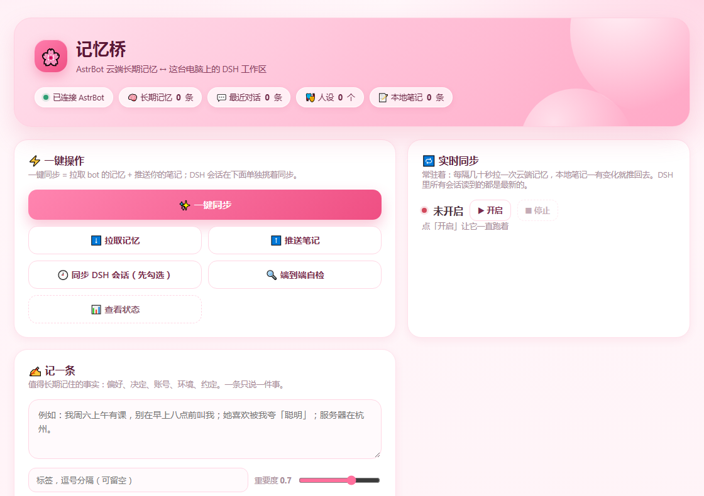
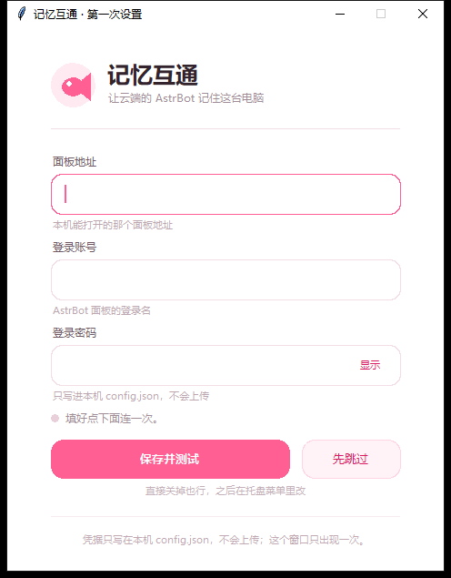

# 记忆互通 · Memory Bridge

AstrBot 的长期记忆 ⇄ 这台电脑上的 DeepSeek Harness 工作区，双向同步。

一个粉色小界面 + 一个托盘图标：云端 bot 记住的事，DSH 会话这边读得到；
DSH 这边做过的事，也能回到 bot 的记忆里。不用复制粘贴，不用手动整理。



## 它做什么

- **拉** — 用 AstrBot 面板的 `import/export` 接口，把 LivingMemory 的记忆、最近对话、人设导出成
  `memory/astrbot/DIGEST.md` 等文件，DSH 会话开始读一下就"记得"了
- **推** — 你在界面里记的一句话（`memory/dsh-notes.jsonl`）会推到云端，落进 bot 的长期记忆
- **挑着回传** — 把选中的 DSH 会话摘要成「【DSH 活动】…」记忆：先选工作区，再勾那几条，只有勾中的会发
- **按人格挑记忆** — bot 里有多个人格时，可以只看某个人的记忆，勾几条传几条；也能把一个人格的记忆打包带走（`bundle-export` / `bundle-import`）
- **实时** — 常驻后每 20 秒拉一次；本地笔记一改就推，DSH 和 bot 读到的是同一批文件

## 下载

到 [Releases](../../releases) 拿现成的，不用装 Python：

| 文件 | 适合 | 大小 |
| --- | --- | --- |
| `memory-bridge-1.1.1-windows-onefile.zip` | 单文件 exe，解压双击就能用 | ~30 MB |
| `memory-bridge-1.1.1-windows-folder.zip` | 文件夹版，启动快，整个文件夹一起拷 | ~31 MB |
| `memory-bridge-1.1.1-source.zip` | 想看代码 / 自己编译 | ~240 KB |

要求：Windows 10/11 64 位。

> exe 是 1.1.1 构建的，首次设置窗是粉色那版，也带「人格与记忆传送」；1.1.0 及更早的 exe 没有这些。
> 单文件版启动稍慢（要解压到临时目录），文件夹版启动快，功能完全一样。

## 快速开始（用 exe）

1. 解压，双击 `记忆互通.exe`
2. 第一次会弹设置窗，填三样：**面板地址**（你本机能打开的那个 AstrBot 面板）、**登录账号**、**登录密码**
3. 点「保存并测试」，显示「连上了：N 条记忆」就对了


4. 之后它待在右下角托盘里（一条蓝头发的鱼），左键点开界面

托盘右键菜单：打开界面 / 一键同步 / 拉取记忆 / 推送笔记 / 实时同步 / 开机自启 /
打开数据文件夹 / 看日志 / 退出。

> 面板在服务器上？先用 SSH 隧道把端口转发到本机，再填本机地址。例如
> `ssh -N -L 6185:127.0.0.1:6185 user@server`，然后面板地址填 `http://127.0.0.1:6185`。

## 快速开始（源码）

```bash
pip install -r requirements.txt
python bridge/app.py            # 起服务并打开界面
python bridge/setup.py --check  # 只想在命令行验一下配置
```

命令行等价物：

```bash
python bridge/astrbot_bridge.py pull                 # 拉云端记忆
python bridge/astrbot_bridge.py note "一句话事实" --tags 偏好
python bridge/astrbot_bridge.py push                 # 推笔记
python bridge/astrbot_bridge.py status               # 看状态
python bridge/realtime.py --once                     # 实时同步跑一轮
```

## 人格与挑选传送

界面上是「人格与记忆传送」这张卡：选人格 → 勾记忆（可搜索）→ 选目标会话 → 传送。
命令行等价：

```bash
python bridge/astrbot_bridge.py personas                     # 有哪些人格、各多少条
python bridge/astrbot_bridge.py pull --persona 默认人格       # 只拉这个人的记忆
python bridge/astrbot_bridge.py transfer --persona 默认人格    # 把这个人的记忆传到所有活跃会话
python bridge/astrbot_bridge.py transfer --ids 4,5 --session <会话> --dry-run
python bridge/astrbot_bridge.py bundle-export --persona 默认人格 --sanitize
python bridge/astrbot_bridge.py bundle-import --file 包.json --session <会话>
```

- 本地 `memories.json` 始终是全量，`--persona` 只影响给人看的 `MEMORY.md` / `DIGEST.md` 和对话拉取。
- 传送 = 写到目标会话，每个会话一份；LivingMemory 的去重键是 `(内容, 会话, 人格)`，重复传不会翻倍。
- 人格包是 `memory-bridge.persona` v1（人格设定 + 去重后的记忆）；`--sanitize` 会把 QQ 号、IP、邮箱、key 换成占位符，适合分享。

## 工作原理

```
LivingMemory (插件)  ──import/export HTTP──  astrbot_bridge.py
                                                  │
                                    memory/astrbot/{DIGEST,MEMORY,recent}.md
                                                  │
                                          DSH 会话读文件
                                                  │
                       memory/dsh-notes.jsonl ── note/push ──> bot 长期记忆
```

DSH 的会话记录是 zstd 压缩的 jsonl，`activity.py` 只读每个文件的前 256 KB 拿标题和首句，
勾选后才解析全文、压成一条「用户让 DSH 做了什么，结果是什么」的记忆。

## 配置

`config.json`（exe 放在旁边；源码模式在 `memory/bridge/config.json`）：

| 字段 | 说明 |
| --- | --- |
| `base` | AstrBot 面板地址，如 `http://127.0.0.1:6185` |
| `panel` | QQBot 面板地址（可选），如 `http://127.0.0.1:8899` |
| `user` / `password` | 面板登录账号密码 |
| `pin` | 面板访问 PIN（用不到可留空） |
| `realtime.interval` | 实时同步间隔秒数，默认 20 |
| `realtime.debounce` | 笔记改动后延迟多少秒再推，默认 4 |
| `realtime.chats` | 拉取最近对话条数，默认 120 |

环境变量：

| 变量 | 作用 |
| --- | --- |
| `MEMORY_BRIDGE_HOME` | 数据根目录（默认源码是 `memory/`，exe 是旁边的 `memory/`） |
| `MEMORY_BRIDGE_CONFIG` | 指定配置文件路径 |
| `MEMORY_BRIDGE_STATE` | 指定已推送内容指纹文件 |
| `QQBOT_PANEL_CONFIG` | 直接复用 QQBot 面板的 `config.json` |

## 界面接口

| 方法 | 路径 | 作用 |
| --- | --- | --- |
| GET | `/api/state` | 概览：连接状态、记忆/笔记条数、实时同步状态 |
| GET | `/api/sessions?workspace=` | 工作区列表 + 会话列表（只读文件头） |
| POST | `/api/activity` | `{"sessions":[...], "dry":true}` 只推勾中的会话 |
| GET/POST | `/api/realtime` | 实时同步 `status` / `start` / `stop` |
| POST | `/api/run` | `{"task":"pull"}`，还有 `push` / `sync` / `selftest` / `status` |
| GET | `/api/job?id=&from=` | 轮询任务输出 |
| POST | `/api/note` | `{"text":"...","tags":["偏好"],"push":true}` |
| POST | `/api/stop` | 关掉后台服务 |

## 自己编译 exe

```powershell
pip install pyinstaller zstandard pystray pillow
powershell -ExecutionPolicy Bypass -File tools\build-exe.ps1
# 只打一个版本： -OneFileOnly / -DirOnly
```

产物：`dist\app\记忆互通.exe`（单文件）与 `dist\app-dir\记忆互通\`（免安装）。

## 目录

| 路径 | 干什么 |
| --- | --- |
| `bridge/astrbot_bridge.py` | 面板登录、记忆 import/export、笔记推送、命令行入口 |
| `bridge/activity.py` | DSH 会话摘要；工作区与会话列举 |
| `bridge/app.py` | 本地 Web 服务 + 界面 API |
| `bridge/realtime.py` | 常驻实时同步 |
| `bridge/desktop.py` | 托盘 / 首启设置窗 / exe 入口 |
| `bridge/setup.py` | 命令行配置向导 |
| `bridge/portable.py` / `source_pack.py` | 打便携包 / 源码包 |
| `bridge/scan_package.py` | 分享前扫个人信息 |
| `ui/index.html` | 界面（单文件，零外部依赖） |
| `tools/build-exe.ps1` | 编译脚本 |

## 常见问题

- **连不上**：地址填错，或面板端口没映射到本机（见上面的 SSH 隧道）
- **"没有找到会话记录"**：Python 3.14 以下没有 `compression.zstd`，装 `zstandard` 就好了
- **杀毒软件报毒**：单文件 exe 常见误报，加信任或改用免安装版
- **托盘图标找不到**：Win11 会把它收进 `^` 溢出区，拖出来固定一下
- **关掉浏览器标签服务还在跑**：它是托盘程序，用托盘「退出」或界面底部的「退出应用」

## 隐私

仓库里没有任何凭据：`config.json`、`state.json`、会话 id、本机路径都在 `.gitignore` 里。
打出来的分享包可以用 `python bridge/scan_package.py <zip>` 自查一遍——扫 IP、账号、密码、
本机路径，输出「干净」再发。

## License

MIT，见 [LICENSE](LICENSE)。
